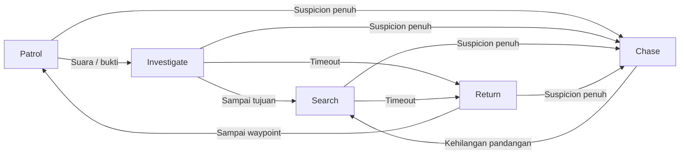

# Penjelasan Pengerjaan Unity — Sneak House

Dokumen pendamping UTS Game Cerdas, topik **Stealth Infiltration**. Mencatat hasil yang sudah dibuat, cara pengerjaan, istilah teknis, dan batas verifikasi per **14 Oktober 2026**.

**[High] Dasar informasi:** kode C# dan scene dalam repository, `STATUS.json`, serta [laporan pengujian Play Mode](unity-prototype-validation.json). Fitur yang belum diuji ditandai terpisah.

## 1. Hasil yang sudah dibuat

Project Unity dapat dibuka menggunakan **Unity 6000.2.10f1**. Prototype menggunakan C#, **Built-in Render Pipeline**, dan kamera top-down miring dengan proyeksi **orthographic**.

| Bagian | Hasil saat ini |
| --- | --- |
| Level | Satu rumah, satu lantai; ruang tamu, kantor, ruang koleksi, dan halaman |
| Player | Satu karakter yang bisa berjalan, berlari, mengendap, dan mengambil target |
| Penjaga | Bogo sebagai satu NPC aktif; dua NPC tambahan tersedia tetapi nonaktif secara default |
| Target | Drive rahasia, jam tangan, dan konsol game |
| Tujuan | Ambil ketiga target, kemudian kembali ke area extraction di pintu masuk |
| Kondisi kalah | Player berada sangat dekat dengan penjaga tanpa penghalang dinding |
| AI | Patrol, Investigate, Chase, Search, Return; vision, hearing, suspicion, dan memory |
| Animasi | Model FBX beserta clip; penggantian animasi berdasarkan gerakan dan kondisi AI |
| UI | Daftar target, jumlah target, suspicion bar, timer, petunjuk interaksi, pause, menang/kalah |
| Debug | State AI, sensor, memori, umur bukti, status path, dan garis rute |
| Integrasi | MCP for Unity terhubung ke editor dan dipakai untuk menjalankan verifikasi |
| Repository | Project awal sudah dipush ke branch `main` repository `henray404/UTS-gameCerdas` |

Model Stan V5 digunakan sebagai **stand-in player**: model sementara dengan jaket hijau. Player final belum dibuat khusus untuk prototype ini.

## 2. Cara pengerjaan dari aset menjadi game

### A. Menetapkan scope permainan

Scope mengikuti pilihan pengguna: satu rumah kecil, satu penjaga aktif, tiga target, dan satu pintu keluar. Scope ini membentuk satu loop permainan yang bisa diuji: masuk, mengamati penjaga, mengambil target, lalu keluar.

### B. Memilih dan mengimpor aset

Aset dipilih dari hasil Sneak House sebelumnya, lalu disalin ke folder `Assets/SneakHouse/Models`. Karakter, furnitur, dan target memakai **FBX**. Unity mengimpor model tersebut menjadi aset yang bisa dipasang dalam scene.

`PrototypeModelImport`, turunan `AssetPostprocessor`, mengatur impor secara otomatis:

- Karakter menggunakan **Generic Rig** dan mengimpor animation clip.
- Clip diatur looping dan transform root dikunci pada pengaturan impor.
- Material memakai shader `Standard`, warna sesuai palet, dan glossiness rendah.
- Ukuran model disesuaikan melalui batas geometri atau **Bounds**, sehingga furnitur dan karakter mempunyai skala yang sesuai di level.

Palet menggunakan krem, kayu cokelat, hijau zaitun, dan aksen kuningan. Font UI: **Changa One** untuk judul dan **Barlow** untuk teks. Lisensi font dan aset Kenney disertakan di `Assets/SneakHouse/Licenses`.

### C. Menyusun scene melalui Editor Script

`PrototypeBuilder.Build()` membuat scene menggunakan API Unity Editor. Script ini membuat lantai, dinding, furnitur, target, karakter, waypoint patroli, kamera, cahaya, dan komponen gameplay, lalu menyimpan `PrototypeHouse.unity`.

Nama teknik yang sesuai: **scripted scene generation** atau **editor automation**. Layout ditulis secara eksplisit dalam kode; belum ada random level generation atau rumah yang berubah otomatis tiap permainan.

Scene menggunakan **cutaway walls**: dinding visual dibuat rendah agar isi rumah terlihat. Di belakangnya tetap ada **BoxCollider** setinggi dinding penuh. Akibatnya, bagian rumah bisa terlihat oleh kamera tanpa membuat penjaga bisa melihat menembus dinding.

Furnitur memakai **collision/navigation proxy**, yaitu bentuk collider sederhana untuk menghalangi gerakan dan dipakai saat membangun NavMesh. Tidak semua benda rendah memblokir pandangan mata penjaga; raycast bergantung pada tinggi collider.

### D. Menambahkan sistem gameplay

Player, target, extraction, AI penjaga, animasi, dan UI dipisahkan ke komponen C#. Hubungan antarkomponen disimpan sebagai referensi pada scene. Pemisahan ini memudahkan penggantian model atau penyesuaian parameter tanpa menulis ulang seluruh game.

### E. Menjalankan dan memeriksa Unity

Scene dibuat melalui Unity Editor, kode dikompilasi, kemudian diperiksa melalui Play Mode. Kendala lisensi pada proses awal ditangani dengan memeriksa Unity Hub melalui **computer use**. Menu `Licenses` ditemukan di sidebar; lisensi Personal tampil, Refresh dilakukan, dan project berhasil dibuka melalui Hub.

MCP kemudian tersambung ke editor. Menu verifikasi dijalankan melalui MCP, lalu hasil JSON dan console diperiksa. Komponen pengujian sempat ditolak karena berada dalam folder `Editor`; komponen tersebut dipindahkan ke `Scripts` dengan pembungkus `#if UNITY_EDITOR`. Setelah perbaikan, 25 pemeriksaan lolos.

## 3. Kontrol dan gerakan player

`PlayerMotor.cs` membaca keyboard menggunakan `Input.GetKey` dan `Input.GetKeyDown`.

| Kontrol | Perilaku |
| --- | --- |
| WASD / arrow | Bergerak di bidang XZ |
| Left Shift | Berlari |
| Left Ctrl / C | Mengendap |
| E | Mengambil target terdekat yang bisa dijangkau |
| F1 | Mengaktifkan atau mematikan AI debug |
| R | Memuat ulang scene |
| Esc | Pause / lanjut |

Gerakan menggunakan **CharacterController.Move**, bukan mendorong karakter menggunakan gaya Rigidbody. Input diagonal dibatasi dengan `Vector3.ClampMagnitude` agar diagonal tidak lebih cepat. Gerak dan rotasi memakai `Time.deltaTime` agar besarnya langkah memperhitungkan waktu antar-frame.

Kecepatan default dalam unit Unity per detik:

- Jalan: **2,5**.
- Lari: **4,0**.
- Mengendap: **1,35**.

Lari memberikan keuntungan kecepatan sekaligus radius stimulus suara lebih besar. Mengendap lebih pelan dan tidak mengirim stimulus langkah pada implementasi sekarang.

## 4. AI penjaga: Finite State Machine

Nama teknik utama: **Finite State Machine (FSM)**. `GuardBrain` menyimpan satu state aktif dan memilih perilaku berdasarkan sensor, suspicion, posisi tujuan, dan waktu.

| State | Perilaku | Pemicu perpindahan utama |
| --- | --- | --- |
| `Patrol` | Mengikuti daftar waypoint; berhenti singkat di titik patroli | Suara memicu Investigate; suspicion penuh memicu Chase |
| `Investigate` | Mendatangi posisi stimulus atau bukti terakhir | Sampai tujuan memicu Search; terlalu lama memicu Return |
| `Chase` | Mengejar posisi yang terlihat, dengan prediksi pendek | Kehilangan penglihatan lebih dari 0,40 detik memicu Search |
| `Search` | Memeriksa posisi memori dan titik sekitar; memutar badan ketika berhenti | Batas waktu pencarian memicu Return |
| `Return` | Menuju waypoint patroli terdekat | Sampai waypoint, memori dibersihkan dan kembali Patrol |

Paparan visual dapat menaikkan suspicion dan memicu Chase dari state lain. Penangkapan diperiksa terpisah dari transisi FSM.

Ini adalah **rule-based game AI**: perilaku ditulis menggunakan aturan dan state. Prototype tidak melatih neural network dan tidak menggunakan machine learning untuk mengambil keputusan penjaga.

## 5. Perception: bagaimana penjaga menerima informasi

### Vision — penglihatan

`GuardBrain.Sees()` melakukan tiga pemeriksaan:

1. Jarak target berada dalam `visionDistance`, default **7,5 unit**.
2. Arah target berada dalam **Field of View (FOV)**, default total **84 derajat**.
3. `Physics.Raycast` tidak mengenai penghalang pada layer `Architecture` sebelum mencapai target.

Nama teknis pemeriksaan penghalang: **line of sight (LOS)** atau **occlusion test**. Player di balik dinding tidak dianggap terlihat walaupun jaraknya dekat.

`VisionCone` membuat mesh visual sektor pandangan dan memotong batasnya berdasarkan raycast ke arsitektur. Cone membantu pemain membaca arah penjaga; keputusan deteksi tetap dilakukan oleh `GuardBrain.Sees()`.

### Hearing — pendengaran

Pendengaran menggunakan **noise stimulus event**, bukan mikrofon atau analisis audio. `PlayerMotor` mengirim posisi, radius, dan jenis langkah melalui `GameSession.Noise`.

- Langkah biasa: radius **1,25 unit**.
- Langkah lari: radius **5,3 unit**.
- Jika ada penghalang, radius efektif dikalikan **0,65**.
- Penjaga yang menerima stimulus mendatangi lokasi suara melalui `Investigate`.

`NoisePulse` menampilkan lingkaran melebar sebagai feedback visual. Sistem stimulus pendengaran ini belum berarti sound effect langkah sudah dipasang.

## 6. Suspicion dan memory

**Suspicion** adalah nilai kecurigaan dari 0 hingga 1. Ketika player terlihat, nilai naik secara bertahap; saat tidak terlihat, nilai turun. Mengendap memperlambat kenaikan suspicion ketika terlihat, tetapi tidak membuat player kebal terhadap vision.

Default laju kenaikan: **1,35 per detik**, atau **0,85 per detik** saat mengendap. Penurunan: **0,55 per detik**. Nilai mencapai 1 memicu Chase.

**Memory** menyimpan informasi yang didapat AI:

| Nama dalam kode | Makna |
| --- | --- |
| `LastKnownPosition` | Posisi bukti terakhir; sering disebut last known position atau LKP |
| `LastSeenTime` | Waktu penglihatan terakhir |
| `LastEvidenceTime` | Waktu bukti terakhir, termasuk suara atau laporan |
| `MemorySource` | Asal bukti: vision, suara, atau shared alert |
| `HasMemory` | Penanda ada atau tidaknya memori aktif |

Player tersembunyi tidak terus memperbarui LKP. Setelah pandangan hilang, penjaga mencari berdasarkan bukti terakhir. Ini membuat AI dapat kehilangan player, bukan selalu mengetahui posisi player.

## 7. Navigation dan tactical behavior

**NavMesh** adalah representasi area yang bisa dilalui NPC. `RuntimeNavigation` membangunnya saat scene mulai menggunakan collider layer **8 / Architecture**. Aktor menggunakan layer **9 / Actors** dan tidak dijadikan sumber bake.

Urutan penting: NavMesh dibangun lebih dahulu, posisi NPC dicocokkan ke NavMesh dengan `NavMesh.SamplePosition`, kemudian `NavMeshAgent` diaktifkan. `DefaultExecutionOrder(-300)` membantu memastikan sistem navigasi dipersiapkan lebih awal.

`NavMeshAgent.SetDestination` meminta agen mencari rute menuju tujuan. Player tetap menggunakan CharacterController; player tidak dikendalikan NavMeshAgent.

Perilaku taktis sederhana yang sudah ditulis:

- **Short target prediction:** saat player terlihat, tujuan chase memakai posisi terakhir ditambah velocity player × 0,35.
- **Search pattern:** memeriksa titik sekitar LKP, dengan offset bergilir kanan, depan, kiri, belakang.
- **Return to patrol:** memilih waypoint terdekat untuk kembali berpatroli.
- **Shared Alert:** laporan posisi dan timestamp diteruskan melalui event ke penjaga lain. Penerima masuk Search jika syarat penerimaan terpenuhi. Kode tersedia; interaksi tiga NPC belum diverifikasi.

Tidak ada cover selection, flanking, atau Behavior Tree pada prototype ini.

## 8. Target, extraction, menang, dan kalah

`PlayerMotor.RefreshLoot()` memilih target belum diambil dalam jarak **1,35 unit**. `Physics.Linecast` mencegah interaksi menembus dinding atau penghalang arsitektur.

`LootTarget.MarkCollected()` menandai target dan menyembunyikan visualnya. `GameSession.AddLoot()` menambah hitungan serta menampilkan feedback.

`ExtractionZone.Check()` memeriksa jarak terhadap area keluar, default radius **1 unit**, dan kelengkapan target. Semua target terkumpul ditambah berada di extraction menghasilkan menang.

Penjaga menangkap player jika jarak kurang dari **0,72 unit** dan tidak ada penghalang pada linecast. Ini merupakan **proximity check**, bukan trigger collider khusus penangkapan.

## 9. Animasi dan tampilan

Karakter memakai **Animator Controller** dengan state `Idle`, `Walk`, `Run`, `LookAround`, dan `FaceActing`. `ActorAnimation.Set()` memilih state dan menggunakan **crossfade** selama 0,16 detik untuk perpindahan animasi.

**Root motion** dimatikan: pergerakan posisi dikendalikan CharacterController atau NavMeshAgent. Clip menggerakkan tubuh karakter, sementara sistem gameplay mengatur perpindahan di level. Mengendap saat ini memakai clip Walk dengan kecepatan playback lebih rendah; belum ada clip sneak khusus.

Kamera orthographic tetap mengarah ke rumah dari atas dengan sudut miring. Pencahayaan terdiri dari **Directional Light** untuk matahari, **Point Light** di teras, ambient lighting, dan soft shadows.

UI dibuat menggunakan **IMGUI / OnGUI**. Ini UI prototype berbasis kode; belum dibuat sebagai Canvas uGUI atau UI Toolkit. HUD memperlihatkan tujuan, progress, kecurigaan, timer, serta hasil misi.

## 10. Struktur file dan tanggung jawab

| File / folder | Fungsi |
| --- | --- |
| `Assets/SneakHouse/Scenes/PrototypeHouse.unity` | Scene permainan yang dibuka dan dijalankan |
| `Scripts/PlayerMotor.cs` | Input, gerakan, stimulus langkah, dan interaksi target |
| `Scripts/GuardBrain.cs` | FSM, perception, suspicion, memory, chase, search, dan shared alert |
| `Scripts/RuntimeNavigation.cs` | Runtime NavMesh bake dan penempatan agen |
| `Scripts/GameSession.cs` | Status misi, jumlah penjaga, event, HUD, pause, restart, win/lose |
| `Scripts/ActorAnimation.cs` | Pemilihan state Animator dan crossfade |
| `Scripts/LootTarget.cs` | Status dan visual target |
| `Scripts/ExtractionZone.cs` | Pemeriksaan syarat keluar |
| `Scripts/VisionCone.cs` | Cone pandangan dan kelas NoisePulse |
| `Scripts/PrototypePlayChecks.cs` | Komponen pengujian sementara; hanya dikompilasi untuk editor |
| `Editor/PrototypeBuilder.cs` | Generasi scene dan pengaturan impor model |
| `Editor/PrototypeEditorBootstrap.cs` | Menu membuka scene dan menghubungkan MCP |
| `Editor/PrototypePlayChecks.cs` | Kelas PrototypeVerification, menu, dan pengatur fase pengujian |
| `Models`, `Materials`, `Fonts`, `Licenses` | Aset visual dan lisensinya |
| `Prefabs/*.controller` | Animator Controller; nama folder tidak berarti semua objek sudah menjadi prefab reusable |
| `Packages/com.coplaydev.unity-mcp` | Package penghubung Unity Editor ke MCP |
| `Tools/MCPServer` | Source server Python MCP |
| `ProjectSettings` | Konfigurasi project Unity |
| `Documentation/unity-prototype-validation.json` | Bukti hasil 25 pemeriksaan |

Path `Scripts/...` dan `Editor/...` dalam tabel berada di bawah `Assets/SneakHouse`.

## 11. MCP dan computer use: perannya berbeda

**MCP — Model Context Protocol** menyediakan antarmuka tool untuk berkomunikasi dengan Unity Editor. Pada project ini, package editor berkomunikasi dengan server lokal; endpoint MCP dikonfigurasi ke `http://127.0.0.1:8080/mcp`.

Penggunaan yang sudah dilakukan: membaca daftar instance editor, membaca state dan console, meminta refresh/compile, serta menjalankan menu verifikasi. Koneksi editor dibuktikan melalui instance `SneakHousePrototype`, bukan hanya keberadaan package.

**Computer use** digunakan untuk mengoperasikan UI Unity Hub: menemukan Licenses, melakukan Refresh, menambahkan folder project dari disk, memilih editor, dan membuka scene. Computer use tidak menjadi komponen gameplay.

MCP juga bukan AI penjaga. AI penjaga adalah kode C# di `GuardBrain`; gameplay tidak memerlukan model bahasa atau server MCP untuk mengambil keputusan.

Menu project:

- `Sneak House / Open prototype`: membuka scene dan menghubungkan MCP.
- `Sneak House / Connect Unity MCP`: menghubungkan bridge editor.
- `Sneak House / Build prototype scene`: membuat ulang scene berdasarkan script; perubahan manual pada scene tersebut dapat tertimpa.
- `Sneak House / Verify prototype gameplay`: menjalankan pemeriksaan Play Mode.

## 12. Pengujian: bukti dan batasnya

**[High] 25 pemeriksaan lolos**, berdasarkan `passed: true` pada laporan JSON. Pemeriksaan mencakup:

- Satu NPC aktif dan tiga target.
- NavMesh terbentuk, agen berada di NavMesh, dan rute lengkap menuju ketiga pendekatan target tersedia.
- State animasi Idle, Walk, dan Run tersedia pada kedua aktor.
- Dinding menghalangi vision; doorway memberi LOS; target di luar FOV tidak terlihat.
- Paparan visual menaikkan suspicion hingga Chase.
- Player tersembunyi tidak memperbarui LKP; kehilangan pandangan memicu Search.
- Hearing memicu Investigate; kedatangan memicu Search; timeout memicu Return.
- Extraction tidak menghasilkan menang sebelum target lengkap.
- `TryInteract()` berhasil mengambil ketiga barang dan hitungan tercatat.
- Extraction setelah target lengkap menghasilkan menang; kontak dekat menghasilkan kalah.

Pengujian menjalankan komponen gameplay dalam Play Mode. Untuk menyiapkan kondisi, test memakai `Teleport`, `NavMeshAgent.Warp`, dan pemanggilan `GuardBrain.Step` dengan delta waktu terkontrol. Ini bukan rekaman pemain menyelesaikan seluruh level memakai keyboard. Pemeriksaan animasi membuktikan keberadaan state, bukan kualitas gerakan tiap frame.

Console diperiksa dan tidak menunjukkan error atau warning pada pemeriksaan akhir. Build standalone, performa pada perangkat lain, keseimbangan difficulty, shared alert antar-NPC, dan durasi 5–10 menit belum dibuktikan oleh laporan tersebut.

Catatan portabilitas pengujian: laporan disimpan ke `Documentation/Verification`; frame preview sementara disimpan ke `Temp/work` di dalam project. Script pembuat asset pada `Tools/Art` menghitung lokasi project dari file script, sehingga tetap dapat dipakai setelah project dipindahkan.

## 13. Hubungan dengan tugas Game Cerdas

| Konsep tugas | Implementasi prototype | Status bukti |
| --- | --- | --- |
| Perception | Vision dan stimulus hearing | Diuji pada satu NPC |
| Memory | LKP, timestamp, sumber bukti | Diuji |
| Movement / Navigation | CharacterController dan NavMeshAgent | NavMesh serta rute target diuji |
| Decision Making | FSM dan ambang suspicion | Transisi utama diuji |
| Tactical Behavior | Prediksi pendek, pola Search, kembali ke waypoint | Logika tersedia; prediksi tidak diuji tersendiri |
| Win / Lose | Semua target + extraction; penangkapan dekat | Diuji |
| AI Debug Mode | State, sensor, memori, path | Implementasi tersedia dan editor dapat menjalankan scene |
| Shared Alert | Event laporan antarpenjaga | Implementasi tersedia; perlu uji beberapa NPC |
| Minimal tiga NPC aktif | Tiga objek tersedia; default hanya satu aktif | Belum memenuhi jumlah NPC tugas akhir |

Prototype mengikuti scope awal pengguna. Untuk versi tugas akhir, tiga NPC aktif harus diuji, durasi permainan perlu dibuktikan, dan hasil build/demo perlu disiapkan.

## 14. Kamus istilah teknis

| Istilah | Arti praktis dalam project |
| --- | --- |
| Scene | File berisi susunan objek permainan dan referensi komponennya |
| GameObject | Wadah objek, misalnya player, penjaga, meja, atau kamera |
| Component / MonoBehaviour | Bagian fungsi yang ditempel pada GameObject |
| Transform | Posisi, rotasi, skala, dan hubungan parent-child objek |
| Collider | Bentuk untuk interaksi fisika, tabrakan, atau raycast |
| Layer / LayerMask | Kelompok objek dan filter pemeriksaan fisika/navigation |
| FSM | Pengambilan keputusan melalui sejumlah state dan aturan transisi |
| FOV | Sudut pandang penjaga |
| Raycast / Linecast | Pemeriksaan apakah garis mengenai collider |
| LOS / Occlusion | Ada atau tidaknya penghalang pandangan |
| Stimulus | Informasi yang diterima sensor, misalnya posisi suara |
| LKP | Last known position; lokasi bukti terakhir yang diketahui AI |
| NavMesh / Bake | Area navigasi dan proses membangunnya dari geometri |
| NavMeshAgent | Komponen NPC untuk mengikuti rute ke destination |
| Waypoint | Titik tujuan dalam rute patroli |
| Animator / AnimationClip | Pemutar animasi dan data gerakan karakter |
| Generic Rig | Pengaturan animasi untuk hierarki tulang yang digunakan model |
| Root Motion | Perpindahan root karakter dari animasi; dimatikan pada prototype |
| Crossfade | Peralihan bertahap antara dua animasi |
| HUD | Informasi permainan yang tampil saat bermain |
| IMGUI / OnGUI | Sistem UI berbasis kode yang digunakan HUD prototype |
| Event / Publish-Subscribe | Pengirim menerbitkan informasi; komponen lain berlangganan untuk menerimanya |
| Editor Script / MenuItem | Otomasi dan menu khusus yang berjalan di Unity Editor |
| AssetPostprocessor | Hook editor untuk mengatur aset selama proses impor |
| GUID / `.meta` | Identitas aset Unity; membantu menjaga referensi scene dan material |
| Play Mode | Menjalankan permainan di dalam editor |
| Compilation / Domain Reload | Kompilasi C# dan pemuatan ulang kode editor/runtime |
| MCP | Protokol tool untuk interaksi dengan editor; terpisah dari AI permainan |
| Git / Remote / Commit | Versi source, tujuan repository, dan snapshot perubahan |

## 15. Pekerjaan yang belum selesai

- Mengaktifkan dan menguji tiga NPC sekaligus, termasuk Shared Alert.
- Memberi peran, kemampuan, gerakan, dan ekspresi unik untuk tiap penjaga di gameplay.
- Mengganti stand-in player dengan karakter final dan menambah clip mengendap khusus.
- Memasukkan rumah mewah, variasi bentuk rumah, lantai dua, serta seluruh 20 tema ruangan dari koleksi aset sebelumnya.
- Membuktikan balancing dan durasi permainan 5–10 menit.
- Menambah sound effect, audio feedback, dan polish UI lebih lanjut.
- Menguji build standalone serta membuat video demo tugas.

## 16. Penjelasan singkat untuk presentasi

> Kami membuat prototype Stealth Infiltration menggunakan Unity 6000.2.10f1. Pemain masuk ke rumah, mengambil tiga target, lalu kembali ke extraction point. Penjaga menggunakan Finite State Machine dengan state Patrol, Investigate, Chase, Search, dan Return. Vision diperiksa melalui jarak, FOV, dan raycast, sedangkan hearing menggunakan stimulus langkah. Penjaga menyimpan posisi bukti terakhir dalam memory dan memakai NavMeshAgent untuk navigasi. Scene disusun melalui editor script dan menggunakan aset low-poly FBX. Sebanyak 25 pemeriksaan Play Mode telah lolos. Prototype sekarang memakai satu NPC aktif; versi akhir tugas masih perlu pengujian tiga NPC, balancing, dan build standalone.
